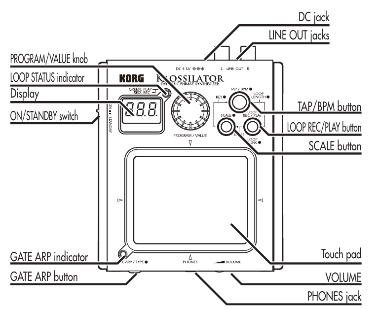

# Korg Kaossilator: operation manual (functional summary)

Extracted from the English section of the official owner's manual, [KO1_OM_EFG1.pdf](https://www.korg.com/us/support/download/manual/1/121/1773/) (2007). Hardware-only content is left out: batteries, power, AC adapter, jacks, specifications and safety notices. See also [scales.md](./scales.md) and [gate-arpeggiator.md](./gate-arpeggiator.md).

## Controls

| Control               | Role                                                                                                  |
| --------------------- | ----------------------------------------------------------------------------------------------------- |
| Touch pad             | Plays the sound. X and Y control the parameters given in the [program list](#program-list).           |
| PROGRAM/VALUE knob    | Selects the program, or edits the value of whichever setting is shown (BPM, scale, key, …).           |
| Display (3 digits)    | 7-segment display. Shows the program number, or the setting being edited.                             |
| TAP/BPM button        | Shows/edits the BPM, sets tap tempo. Shift for KEY (with SCALE) and LOOP LENGTH (with LOOP REC/PLAY). |
| SCALE button          | Shows/edits the scale. Shift for KEY (with TAP) and LOOP ERASE (with LOOP REC/PLAY).                  |
| LOOP REC/PLAY button  | Loop recording, playback and overdub. Hold it as a shift for loop functions.                          |
| LOOP STATUS indicator | Red = recording, green = playing, orange = processing (cancel/fix/clear).                             |
| GATE ARP button       | Turns the gate arpeggiator on or off. Hold it to pick a pattern (labelled GATE ARP / TYPE).           |
| GATE ARP indicator    | Lit while the gate arpeggiator is on.                                                                 |
| VOLUME                | Headphone volume only. It doesn't affect LINE OUT.                                                    |

Button combinations printed on the panel:

- **SCALE + TAP**: KEY (root note/octave)
- **LOOP REC/PLAY + TAP**: LOOP LENGTH
- **LOOP REC/PLAY + SCALE**: LOOP ERASE (shown as "LOOP FUNC" / "ERASE" on the panel)

## Modes and the display

The unit is normally in the **program selection state**: the display shows the program number, and the knob changes the program. Each setting button switches the display and knob to that setting. To go back to program selection, press or hold the same button again, or wait:

| Setting       | Enter                          | Leave                                | Auto-return |
| ------------- | ------------------------------ | ------------------------------------ | ----------- |
| BPM           | press TAP                      | press and hold TAP                   | 5 s         |
| Scale         | press SCALE                    | press SCALE                          | 5 s         |
| Key           | hold SCALE + press TAP         | hold SCALE + press TAP again         | 5 s         |
| Gate arp type | press and hold GATE ARP        | press and hold GATE ARP again        | 5 s         |
| Phrase length | hold LOOP REC/PLAY + press TAP | hold LOOP REC/PLAY + press TAP again | 15 s        |

"Auto-return" means it goes back to program selection after that many seconds with no further edits.

### Power-on defaults

Settings aren't saved: turning the unit off resets them.

| Setting       | Default        |
| ------------- | -------------- |
| BPM           | 120            |
| Scale         | `Ion` (Ionian) |
| Key           | C (C4)         |
| Gate arp      | `G.00`         |
| Phrase length | 8 (beats)      |
| Recorded loop | erased         |

## Programs

- **100 programs**, numbered `*.00`–`*.99`. The prefix letter is the category (`L` lead, `a` acoustic, `b` bass, `c` chord, `S` SE, `d` drum, `P` pattern). Turn PROGRAM/VALUE to select one.
- Move your finger on the pad or tap it to play. **Touching the extreme outer edges of the pad doesn't control the sound** (a dead zone).
- Each program decides what the X and Y axes control, and whether the scale and gate arp apply to it. See the [program list](#program-list).

## Gate arpeggiator

- Press **GATE ARP**: the indicator lights, and the sound is now "gated" (chopped rhythmically) with the selected pattern while you play the pad. It's tempo-synced to the BPM.
- **Select a pattern**: press and hold GATE ARP. The display shows the current pattern (`G.00`). Turn the knob to pick `G.00`–`G.49`. Press and hold GATE ARP again to go back (or wait 5 s).
- Some programs don't support the arp (the GATE ARP column in the program list). The patterns themselves are in [gate-arpeggiator.md](./gate-arpeggiator.md).
- Default: `G.00`.

## Scale

- Press **SCALE**: the display shows the abbreviation of the current scale (e.g. `Ion`). Turn the knob to pick one, then press SCALE again to go back (or wait 5 s).
- With a scale selected, the X axis is quantized to the notes of that scale. With `OFF`, the pitch is continuous.
- Some programs ignore the scale (the SCALE column in the program list).
- Default: `Ion` (Ionian). The full list of 31 scales is in [scales.md](./scales.md).

## Key (root note / octave)

- **Hold SCALE and press TAP**: the display shows the current key. Turn the knob to change it. Press TAP again while holding SCALE to go back (or wait 5 s).
- The key sets both the **root note** and the **octave** of the pad's note range.
- The manual shows how the display encodes it. The first digit is the note letter, the second digit shows a sharp sign for sharp notes, and the third digit marks the octave with a segment:

  | Key | Display                                   |
  | --- | ----------------------------------------- |
  | C4  | `C` (third digit blank)                   |
  | C#4 | `C` + `°` (sharp sign in second digit)    |
  | C3  | `C` + `_` (bottom segment on third digit) |
  | C5  | `C` + `‾` (top segment on third digit)    |

  So the selectable range runs from C3 to C5 with every semitone in between. The manual only gives these four examples, so this is an inference from them.

- On some programs, changing the key can cause noise or no sound.
- Default: C4.

## Tempo (BPM)

1. Press **TAP**: the display shows the current BPM.
2. **Manual**: turn the knob while the BPM is shown.
3. **Tap tempo**: hit TAP several times in time with the music; the detected BPM becomes the setting.
4. Press and hold TAP to go back (or wait 5 s).

- The BPM drives the gate arpeggiator, the tempo-synced effects in some programs, and the loop length.
- The manual mentions BPM values from 20 up (see [phrase length](#phrase-length)).
- Default: 120.

## Loop (phrase) recording

The Kaossilator records what you play on the pad as a loop and plays it back, so you can play over it and add layers. **A phrase can be up to 8 beats (2 bars of 4/4) long.**

### Record, play, stop

1. **Press and hold LOOP REC/PLAY**: LOOP STATUS turns red. Whatever you play on the pad while it's held is recorded.
2. **Release**: LOOP STATUS turns green. Playback continues, recording stops.
3. **Press LOOP REC/PLAY** during playback: the light goes out and playback stops.
4. **Press LOOP REC/PLAY** while stopped: the light turns green and playback starts again.

### Overdub (layering)

- During playback you can just play along, or **press and hold LOOP REC/PLAY** to record another layer on top. This can be repeated.

### Saving, cancelling, merging and clearing layers

A layered phrase can be **saved** as a restore point, so that layers you add later can be undone.

1. **Save (Fix)**: after recording, keep holding LOOP REC/PLAY. The display shows `---` (stopped) or `b.1` (playing, digit = beat position). Turn the knob until `FiX` shows, then release. The current phrase and layers are saved.
2. **Record more layers**: press and hold LOOP REC/PLAY as usual.
3. **Cancel**: keep holding LOOP REC/PLAY and turn the knob until `Can` shows, then release. Only the new layers recorded since the save are deleted.
4. **Merge**: keep holding LOOP REC/PLAY and turn the knob until `FiX` shows, then release. The new layers are merged into the saved phrase.
5. **Clear**: keep holding LOOP REC/PLAY and turn the knob until `CLr` shows, then release. Everything is deleted, including the saved phrase.

While each of these runs, the display blinks and LOOP STATUS lights orange. Turning the power off deletes all phrases, including the saved one.

### Erasing parts of the loop

- **Erase**: during playback, hold LOOP REC/PLAY and press SCALE. The parts of the loop that play while SCALE is held are deleted. The display shows `Er.1` (the digit is the beat position).
- **Replace**: while recording with LOOP REC/PLAY held during playback, press SCALE. The previously recorded material is replaced by what you're playing now (display `Er.1` again).
- Neither operation touches the saved phrase.

### Phrase length

1. **Hold LOOP REC/PLAY and press TAP**: the display shows the current loop length.
2. Turn the knob to set it: **1/16, 1/8, 1/4, 1/2, 1, 2, 4 or 8** (in beats).
3. Press TAP again while holding LOOP REC/PLAY to go back (or wait 15 s).

- **At slow tempos the actual length is shortened:**
  - BPM 20–37.5: the actual length is 1/4 of the displayed length.
  - BPM 37.5–75.0: the actual length is 1/2 of the displayed length.

- Default: 8 beats.

## Program list

**X/Y** = what the touch pad axes control. **Scale** / **Arp** = whether the scale and the gate arpeggiator apply to that program (○ = yes, — = no).

### Lead (L.00–L.19)

| No.  | Program        | X axis    | Y axis                 | Scale | Arp |
| ---- | -------------- | --------- | ---------------------- | :---: | :-: |
| L.00 | Ambient Lead   | Note      | Ambient Depth, Vibrato |   ○   |  ○  |
| L.01 | LR 5th Lead    | Note      | Pan, Delay Cutoff      |   ○   |  ○  |
| L.02 | Unison Lead    | Note      | Cutoff                 |   ○   |  ○  |
| L.03 | Tell Min       | Note      | Level                  |   ○   |  ○  |
| L.04 | Feedback Lead  | Note      | Feedback Mod           |   ○   |  ○  |
| L.05 | Sync Lead      | Note      | OSC Sync Pitch         |   ○   |  ○  |
| L.06 | Square Bell    | Note      | Decay Time             |   ○   |  ○  |
| L.07 | Wide Saw Lead  | Note      | Delay&AutoPan Depth    |   ○   |  ○  |
| L.08 | XMod Lead      | Note      | Mod Depth              |   ○   |  ○  |
| L.09 | Square Lead    | Note      | Cutoff                 |   ○   |  ○  |
| L.10 | Unison Sweep   | Note      | Cutoff                 |   ○   |  ○  |
| L.11 | 3Octave Lead   | Note      | Octave                 |   ○   |  ○  |
| L.12 | XY Scale       | Note      | Bass Note              |   ○   |  ○  |
| L.13 | Wave Seq       | Note, Pan | Sequence Speed         |   ○   |  ○  |
| L.14 | Digital Talk   | Note      | Formant                |   ○   |  ○  |
| L.15 | LFO Lead       | Note      | LFO Speed              |   ○   |  ○  |
| L.16 | XMod Saw Lead  | Note      | Cutoff                 |   ○   |  ○  |
| L.17 | Flap Lead      | Note      | LFO Speed              |   ○   |  ○  |
| L.18 | Tape Bell Lead | Note      | Echo Time, Feedback    |   ○   |  ○  |
| L.19 | Pitch Mod Lead | Note      | Pitch Mod Depth        |   ○   |  ○  |

### Acoustic (a.20–a.29)

| No.  | Program        | X axis | Y axis            | Scale | Arp |
| ---- | -------------- | ------ | ----------------- | :---: | :-: |
| a.20 | Trumpet        | Note   | Breath Pressure   |   ○   |  ○  |
| a.21 | Piano          | Note   | Velocity          |   ○   |  ○  |
| a.22 | Digerido       | Note   | LFO Speed         |   ○   |  ○  |
| a.23 | Electric Sitar | Note   | Sound Character   |   ○   |  ○  |
| a.24 | Duo Strings    | Note   | 2nd Strings Level |   ○   |  ○  |
| a.25 | VPM Bell       | Note   | Sound Character   |   ○   |  ○  |
| a.26 | Jazz Guitar    | Note   | Velocity          |   ○   |  ○  |
| a.27 | Tenor Sax      | Note   | Breath Pressure   |   ○   |  ○  |
| a.28 | Harmonica      | Note   | 2nd Reed Level    |   ○   |  ○  |
| a.29 | Flute          | Note   | Breath Pressure   |   ○   |  ○  |

### Bass (b.30–b.49)

| No.  | Program         | X axis | Y axis           | Scale | Arp |
| ---- | --------------- | ------ | ---------------- | :---: | :-: |
| b.30 | Hoover          | Note   | Cutoff, Pitch EG |   ○   |  ○  |
| b.31 | Kick Bass       | Note   | Decay Time       |   ○   |  ○  |
| b.32 | Reso Bass       | Note   | Cutoff           |   ○   |  ○  |
| b.33 | Acid Bass       | Note   | Distortion       |   ○   |  ○  |
| b.34 | Sync LFO Bass   | Note   | LFO Speed        |   ○   |  ○  |
| b.35 | Unison Bass     | Note   | Cutoff           |   ○   |  ○  |
| b.36 | Boost Bass      | Note   | Cutoff           |   ○   |  ○  |
| b.37 | XMod Bass       | Note   | Cutoff           |   ○   |  ○  |
| b.38 | Fall Bass       | Note   | Cutoff           |   ○   |  ○  |
| b.39 | VPM Bass        | Note   | Decay Time       |   ○   |  ○  |
| b.40 | Modulation Bass | Note   | Mod Depth        |   ○   |  ○  |
| b.41 | Dark Bass       | Note   | Mod Depth        |   ○   |  ○  |
| b.42 | Ring Bass       | Note   | Cutoff           |   ○   |  ○  |
| b.43 | Square Bass     | Note   | Cutoff           |   ○   |  ○  |
| b.44 | Dist Saw Bass   | Note   | Cutoff           |   ○   |  ○  |
| b.45 | MG Bass         | Note   | Cutoff           |   ○   |  ○  |
| b.46 | Bit Bass        | Note   | Cutoff           |   ○   |  ○  |
| b.47 | Synth Bass      | Note   | Cutoff           |   ○   |  ○  |
| b.48 | Valve Bass      | Note   | Decay Time       |   ○   |  ○  |
| b.49 | Organ Bass      | Note   | 3rd Percussion   |   ○   |  ○  |

### Chord (c.50–c.59)

| No.  | Program       | X axis | Y axis             | Scale | Arp |
| ---- | ------------- | ------ | ------------------ | :---: | :-: |
| c.50 | Trance Chord  | Note   | Cutoff             |   ○   |  ○  |
| c.51 | Sine Chord    | Note   | Octave             |   ○   |  ○  |
| c.52 | Organ Chord   | Note   | Drawbar Level      |   ○   |  ○  |
| c.53 | Sweep Chord   | Note   | LFO Speed          |   ○   |  ○  |
| c.54 | Choir Chord   | Note   | Formant            |   ○   |  ○  |
| c.55 | Power Chord   | Note   | Sound Character    |   ○   |  ○  |
| c.56 | BPF Chord     | Note   | Cutoff             |   ○   |  ○  |
| c.57 | E.Piano Chord | Note   | Chord (Maj7, min7) |   ○   |  ○  |
| c.58 | Rave Chord    | Note   | Cutoff             |   ○   |  ○  |
| c.59 | Chord Hit     | Note   | Chord (Maj7, min7) |   ○   |  ○  |

### SE / sound effects (S.60–S.79)

| No.  | Program        | X axis                  | Y axis              | Scale | Arp |
| ---- | -------------- | ----------------------- | ------------------- | :---: | :-: |
| S.60 | Kaoss Drone    | Cutoff                  | Feedback            |   —   |  ○  |
| S.61 | Rise & Fall    | Note                    | Rise, Fall          |   ○   |  ○  |
| S.62 | Feedback Loop  | Feedback Filter         | Delay Time          |   —   |  ○  |
| S.63 | L->R           | Note                    | LFO Speed           |   ○   |  ○  |
| S.64 | Noise Filter   | Cutoff                  | Resonance           |   —   |  ○  |
| S.65 | 8bit Game      | Note                    | Pitch Mod Depth     |   ○   |  ○  |
| S.66 | Metal          | Note, Cutoff            | LFO Speed           |   ○   |  ○  |
| S.67 | Siren          | LFO Speed, Cutoff       | Pitch Mod Depth     |   —   |  ○  |
| S.68 | Missile        | Missile, Hit            | Decay Time          |   —   |  ○  |
| S.69 | Random         | Note                    | LFO Speed           |   ○   |  ○  |
| S.70 | Beam Saber     | Modulator Note          | Mod Depth           |   ○   |  ○  |
| S.71 | Synth Looper   | Cutoff, Looper Speed    | Looper, Noise Level |   —   |  ○  |
| S.72 | Ring Mod SFX   | Note                    | LFO Depth           |   ○   |  ○  |
| S.73 | Square LFO     | Note, LFO Speed         | Cutoff              |   ○   |  ○  |
| S.74 | Dot Eat        | Loop Pitch              | Dot Eat             |   —   |  ○  |
| S.75 | Voice Looper   | Note, Looper Speed, Pan | Looper, Formant     |   ○   |  ○  |
| S.76 | Sweep          | Note, Pan               | LFO Speed           |   ○   |  ○  |
| S.77 | Jet            | Comb Freq               | Feedback            |   —   |  ○  |
| S.78 | Reflection SFX | Note                    | Decay Time          |   ○   |  ○  |
| S.79 | Drop           | Cutoff                  | Impulse Speed       |   —   |  ○  |

### Drum (d.80–d.89)

| No.  | Program      | X axis       | Y axis               | Scale | Arp |
| ---- | ------------ | ------------ | -------------------- | :---: | :-: |
| d.80 | BD/SD1       | BD, SD       | Sound Character      |   —   |  ○  |
| d.81 | Zap/HH       | Zap, HH, Pan | Decay Time           |   —   |  ○  |
| d.82 | Conga        | Conga Hi/Low | Mute                 |   —   |  ○  |
| d.83 | BD/SD2       | BD, SD       | SD Decay Time        |   —   |  ○  |
| d.84 | Breakdown    | Decay Time   | Ambient Depth        |   —   |  ○  |
| d.85 | XMod Perc    | Pitch        | Mod Depth, Mod Pitch |   ○   |  ○  |
| d.86 | BD/SD3       | BD, SD       | BD Pitch, SD Level   |   —   |  ○  |
| d.87 | Timpani      | Note         | Velocity             |   ○   |  ○  |
| d.88 | Filter Snare | Noise Cutoff | SD Body Level        |   —   |  ○  |
| d.89 | BD/SD4       | BD, SD       | Reverse              |   —   |  ○  |

### Drum pattern (P.90–P.99)

| No.  | Program     | X axis       | Y axis                   | Scale | Arp |
| ---- | ----------- | ------------ | ------------------------ | :---: | :-: |
| P.90 | Grain Beat1 | Pattern      | Grain Depth              |   —   |  —  |
| P.91 | Bass&Drum   | Bass Note    | Pattern, Flanger Depth   |   ○   |  ○  |
| P.92 | HPF Drum    | Pattern      | Cutoff, Delay Depth      |   —   |  —  |
| P.93 | Grain Beat2 | Pattern      | Grain Speed              |   —   |  —  |
| P.94 | Beat Box    | Pattern      | Delay Depth              |   —   |  —  |
| P.95 | Dirty Drum  | Pattern      | Decimator Depth          |   —   |  —  |
| P.96 | Grain Beat3 | Pattern      | Grain Depth              |   —   |  —  |
| P.97 | House       | Pattern      | Delay Depth              |   —   |  —  |
| P.98 | Auto Techno | Bass Note    | Pattern, Cutoff          |   ○   |  ○  |
| P.99 | Electro     | Noise Cutoff | Noise Decay, Delay Depth |   —   |  —  |

## Notes for this recreation

What the manual implies for the web version:

- **X axis = note**, quantized to key + scale; **Y axis = a per-program parameter** (most often filter cutoff; only L.03 Tell Min uses Level). The app's current Y = volume is a simplification.
- Pad edges are a **dead zone**.
- **Lifting the finger stops the note.** Tapping is a valid way to play, so a short tap should trigger a short note.
- The **gate arp** chops the held note in time with the BPM, using the selected pattern.
- The **key** covers C3–C5, and the **scale** defaults to Ionian. Settings reset on reload, just as the device resets them at power-off.
- **Loop recording**: the manual talks about recording "phrases and patterns that you play on the touch pad" but doesn't say whether it stores audio or pad gestures. For a web version, recording gestures (position over time) is simpler and lets edits re-render. Max 8 beats, with overdub, save/cancel/merge/clear and erase while SCALE is held.
