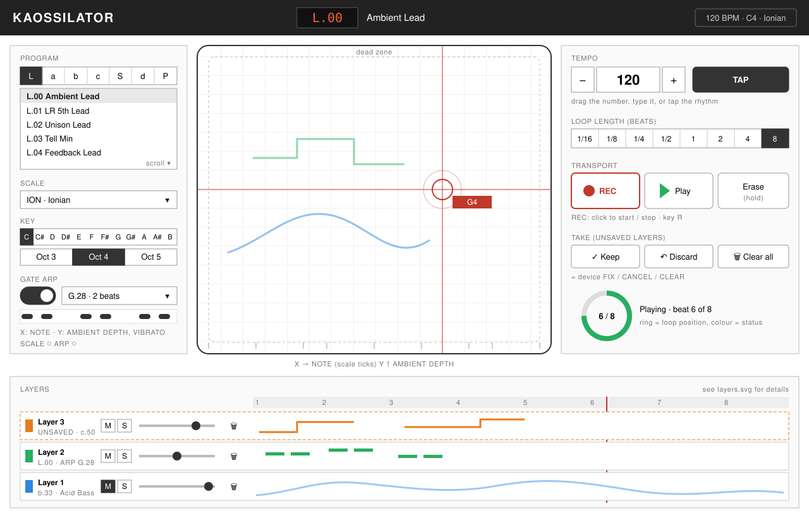

# Web interface proposal

Wireframes for a web Kaossilator that keeps the device's behaviour (programs, scale/key, BPM and tap tempo, gate arp, loop record/overdub/save/erase, loop length) but **replaces every hidden mode and two-button combination with a visible control**, and adds a **Layers** view.

| File                         | What it shows                                              |
| ---------------------------- | ---------------------------------------------------------- |
| [desktop.svg](./desktop.svg) | Desktop layout: settings on the left, pad in the middle, tempo/loop on the right, layers at the bottom |
| [layers.svg](./layers.svg)   | Close-up of one layer: touch timeline, volume, erase by selection |
| [mobile.svg](./mobile.svg)   | Phone layout: pad first, transport under it, settings in bottom sheets |

## Principles

1. **No modes, no combos.** On the device, the knob and display are shared by every setting, so you need modes and two-button combinations to reach them. On the web every setting gets its own control and is always visible (desktop) or one tap away (mobile).
2. **The pad is always playable.** Nothing covers it. On mobile, the settings sheets open below it.
3. **Keep the device's vocabulary** (program numbers like `L.00`, `ION`, `G.28`, the red LCD) so it still feels like a Kaossilator and the docs in this folder still apply.
4. **Loops are data, not audio.** A layer stores touch events (time, x, y, down/up) plus the program, scale, key and arp used for it. That's what makes the per-layer view, volume, mute and erase possible. It also means a layer can be re-quantized or replayed with a different sound later.

## Device control → web control

| Device                                             | Web                                                                 |
| -------------------------------------------------- | ------------------------------------------------------------------- |
| Turn PROGRAM/VALUE to pick a program               | Category tabs (`L a b c S d P`) + scrollable list; header shows the LCD number and name. ←/→ keys step through programs. |
| SCALE, then knob                                   | Scale dropdown (`ION · Ionian` …, all 31 + OFF)                     |
| **Hold SCALE + TAP**, then knob (key)               | 12 note buttons + an octave selector (3 / 4 / 5)                       |
| TAP, then knob (BPM)                               | Number field with −/+; drag or scroll it; type a value             |
| Tap TAP repeatedly                                 | **TAP** button (also the `T` key)                                    |
| GATE ARP on/off                                    | Toggle switch                                                       |
| **Hold GATE ARP**, then knob (pattern)               | Pattern dropdown with a preview of the gate rhythm                     |
| **Hold LOOP REC/PLAY + TAP**, then knob (length)     | Segmented control `1/16 … 8`, always visible                        |
| Hold LOOP REC/PLAY to record                       | **REC**: click to start/stop recording (toggle only). `R` key does the same. |
| Press LOOP REC/PLAY to play/stop                   | **Play/Stop** button (`Space`)                                       |
| Hold REC + knob → `FiX` / `Can` / `CLr`            | **Keep / Discard / Clear all**: shown while there's an unsaved take, also inline on the unsaved layer row |
| **Hold LOOP REC/PLAY + SCALE** (erase while held)    | **Erase** hold button (live, like the device) *and* select a range on a layer's timeline → Erase selection |
| LOOP STATUS LED (red/green/orange)                 | Loop ring (desktop) or progress bar (mobile): its colour shows the status and it fills with the beat position |
| Program list sheet (what X/Y do)                   | Axis labels around the pad, plus a small "X: … · Y: …" line under the program |
| Pad edge dead zone                                 | A dashed inner border on the pad                                         |

## Layers view

See [layers.svg](./layers.svg).

- **One row per recording pass.** Each layer gets a colour, a name, and a sub-label with the program/arp it was recorded with.
- **Controls per layer:** mute (M), solo (S), volume slider (one gain node per layer), delete.
- **Timeline:** the loop's beats run left to right with a shared playhead.
  - Vertical position = pitch, drawn on a grid of the scale's notes, so quantized notes appear as steps.
  - Line thickness = the Y-axis value.
  - ● finger down, ○ finger up; gaps are silence.
  - With the gate arp on, the line is drawn as gate blocks (see Layer 2 in desktop.svg).
- **Editing:** drag across the timeline to select a range, then erase it, duplicate it to a new layer, or re-quantize it to the current scale.
- **Hover a layer** to highlight its trail on the pad (the pad shows faded trails of all layers).
- **Unsaved take:** the current take shows as a dashed orange row with Keep/Discard. That's the device's save/cancel/merge model, made visible: saved layers are the restore point, and Discard drops everything since the last Keep.

## Mobile

See [mobile.svg](./mobile.svg).

- **Layout:** an LCD/status strip at the top (tap it to jump to Sound), the square pad, a loop progress bar, big REC / PLAY / ERASE buttons, and the take bar when there's an unsaved take.
- **Bottom tabs:** Sound (program, scale, key), Tempo (BPM, tap, loop length, arp), Loop (take actions), Layers. Each opens a bottom sheet, and the pad stays playable above it.
- **Layers sheet:** a full-height sheet with the same rows as desktop. The timelines are shorter there; tap a row to expand it for editing.

## Decisions

1. **REC is a toggle only.** Click to start recording, click again to stop. There's no hold-to-record punch-in. The hold-to-erase button stays.
2. **Start with a small subset of programs**, keeping the device's numbering (`L.00`, `b.33`, …) so more can be added later without renumbering.
3. **Each layer keeps its own program.** Changing the program affects only what you play or record next, not the existing layers. Each layer shows the program it was recorded with.
4. **No limit on the number of layers.**
5. **No tempo-based loop shortening.** The device halves the loop below 75 BPM and quarters it below 37.5 BPM, because its memory only holds a fixed amount of time. The web version has no such limit, so the loop length is always what you set (max 8 beats). This can be revisited later.
